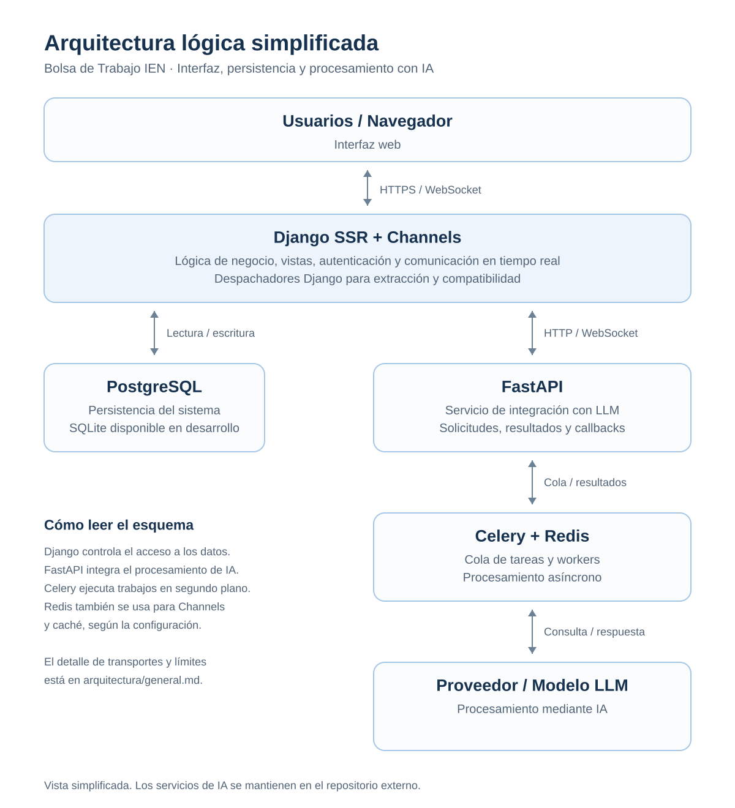
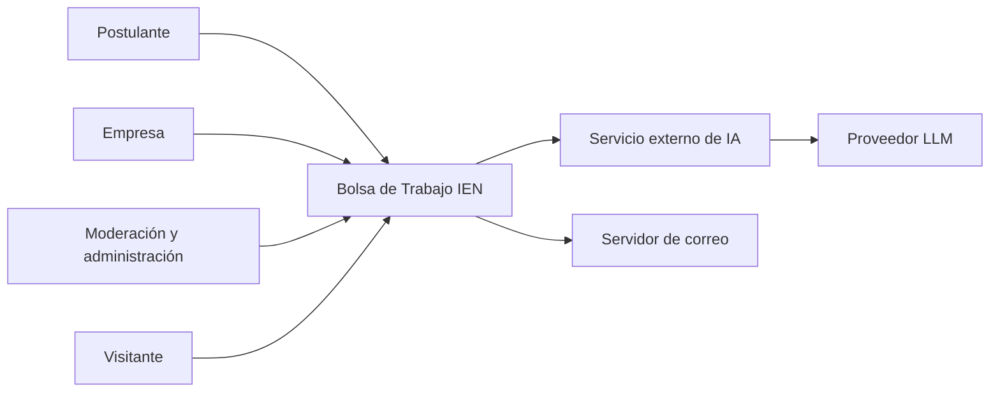
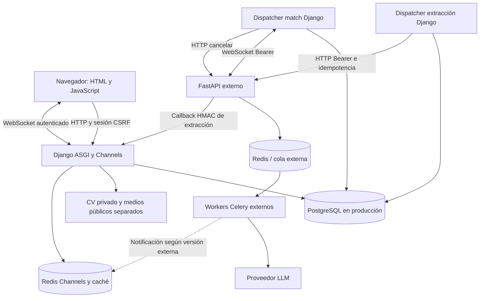

# Arquitectura general

Componente 03 de la guía. Responsable sugerido: responsable técnico con revisión del equipo. Actualizar cuando cambien límites de servicios, integraciones o decisiones estructurales.

Revisión: 22/10/2026. Django usa MVT: modelos para persistencia, formularios para validación, servicios para casos de uso, vistas para HTTP y templates con JavaScript para interfaz. El stack declarado es Python, Django >=5.2,<6, Channels/Daphne, PostgreSQL/SQLite, Redis, Requests, WebSockets y Pydantic. La cabecera generada de algunos archivos menciona Django 6; la dependencia efectiva la define `requirements.txt`.

## Vista lógica simplificada

Diagrama reconstruido a partir de la imagen de referencia, con todos los componentes visibles y sin los controles de la captura. [Versión PNG](diagramas/arquitectura-logica.png) y [fuente Mermaid editable](diagramas/arquitectura-logica.mmd).

SSR significa que Django genera el HTML del lado del servidor. Channels atiende la comunicación en tiempo real. PostgreSQL conserva los datos de negocio; FastAPI coordina la integración con el procesamiento asíncrono de IA. Los despachadores Django entregan trabajos de extracción y compatibilidad al servicio externo.

Esta vista agrupa Celery y Redis para facilitar la lectura. Los roles de Redis para Channels/caché y para la cola externa son distintos; el esquema de contenedores de abajo los separa. No representa una conexión directa de PostgreSQL al proveedor LLM.

## Contexto

## Contenedores y límites

Redis/cola y Celery pertenecen al despliegue del servicio externo: aquí no hay aplicación Celery ni `docker-compose` propio. Los dos despachadores de Django son procesos separados de la web y deben iniciarse además del stack descrito en el README. La topología interna de FastAPI/Celery es referida por la documentación existente y debe verificarse en su repositorio.

## Responsabilidad por módulo

| Módulo | Responsabilidad |
| --- | --- |
| usuarios | Identidad por email, empresas/postulantes, carga y descarga de CV. |
| categorias | Catálogo compartido de categorías y competencias. |
| ofertas | Publicación, estados, búsqueda y favoritas. |
| cursos | Catálogo de formación y competencias desarrolladas. |
| moderacion | Operaciones staff sobre empresas, ofertas y catálogos; sin tabla propia actual. |
| emails | Servicios y plantillas de notificación; sin entidad propia actual. |
| ia | Versiones de CV, extracción/normalización, perfiles canónicos, outbox y recepción. |
| matching | Solicitudes de compatibilidad, rúbricas, caché, cancelación y resultados. |
| ien_contracts | Esquemas Pydantic y validaciones compartidas; no tablas ORM. |

## Flujos críticos

1. **Publicación:** empresa validada crea oferta pendiente; moderación decide; las ofertas activas son elegibles para matching. Los servicios preparan el perfil canónico de oferta.
2. **CV:** carga validada crea `CVVersion` en almacenamiento privado y actualiza el puntero del postulante; solicitar análisis crea `AnalisisCV`, `TrabajoExtraccion` y un `EventoSalida`. El dispatcher manda el snapshot, la API devuelve un job y el callback firmado entrega el resultado. Se valida identidad, hash y vigencia antes de publicar el perfil.
3. **Edición del perfil:** mantiene versiones e inicia normalización cuando procede. Se conserva la versión de base para no sobreescribir una edición concurrente con un resultado tardío.
4. **Compatibilidad:** se bloquean/recargan perfiles, se comprueba vigencia y configuración, se calcula clave de caché y se guarda snapshot. El outbox entrega `match.start`; estados y resultado vuelven por WebSocket servidor a servidor; Django avisa a la sesión propietaria. Cancelar registra una cancelación remota y evita completar localmente un trabajo cancelado.
5. **Recomendación:** el resultado completado se cruza con cursos y habilidades locales; no genera otra inferencia.

## Decisiones registradas

- [ADR-001: persistencia y protección de archivos](adr/001-persistencia-y-cv.md).
- [ADR-002: integración asíncrona e idempotencia](adr/002-integracion-asincrona.md).

Estos ADR registran decisiones observadas en código; no atribuyen aprobaciones históricas al equipo.
