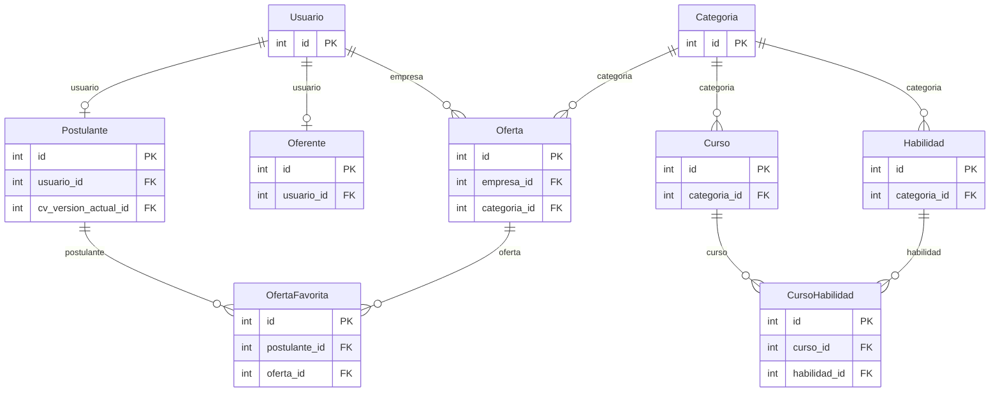
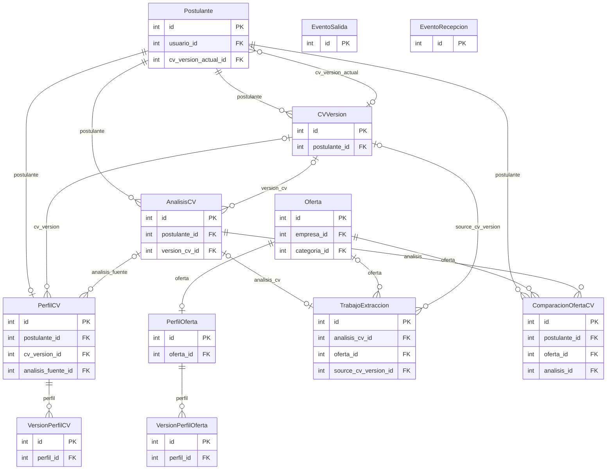
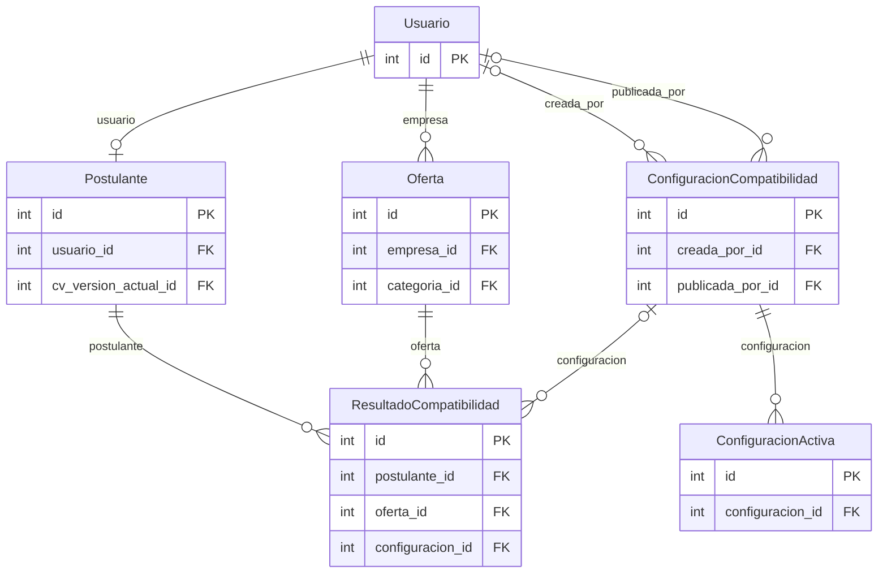

# Modelo de datos de Bolsa de Trabajo IEN

Componente 05 de la guía. Responsable sugerido: responsable de datos. Actualizar cuando cambien esquema, migraciones, integridad o tratamiento de datos.

Revisión: 22/10/2026. Fuente: modelos ORM y grafo de migraciones del código local, incluidos cambios sin commit. Se extrajeron **21 entidades propias y 212 campos locales** sin leer filas de personas. Este documento describe el esquema declarado; no acredita que una base productiva tenga todas las migraciones aplicadas.

## Convenciones y alcance

PK: clave primaria; FK: clave foránea; 1:1: relación única; N:M: muchos a muchos. `null` describe la columna; `blank` describe validación de formularios/modelos. `choices` y validadores no equivalen por sí solos a CHECK de base. El ORM crea índices para PK, unique y FK según el motor; abajo se distinguen los índices explícitos. Los nombres de columnas FK terminan en `_id`.

Las tablas de grupos, permisos, sesiones, administración y migraciones son infraestructura Django y no cuentan entre las 21 entidades. Usuario hereda también relaciones N:M a grupos/permisos. Moderación, emails e ien_contracts no agregan entidades propias vigentes. La BD almacena rutas de archivos, no sus bytes.

## Lectura del dominio

- Usuario puede tener cero o un Postulante y cero o un Oferente; no hay una restricción que haga estos perfiles excluyentes.
- Oferta.empresa referencia Usuario. La autorización de empresa aprobada vive en la aplicación, no en una FK a Oferente.
- Categoria se protege mientras la usen Oferta, Curso o Habilidad. Las habilidades de una oferta son texto/JSON; no existe una FK desde cada requisito al catálogo Habilidad.
- Curso declara habilidades mediante tabla puente automática `cursos_curso_habilidades`, con pareja única curso/habilidad.
- Postulante tiene muchas CVVersion; el puntero opcional cv_version_actual marca la vigente. AnalisisCV y PerfilCV pueden conservar referencias a una versión.
- PerfilCV y PerfilOferta tienen una relación 1:1 con su entidad y muchas versiones históricas.
- ResultadoCompatibilidad enlaza candidato/oferta y, opcionalmente, configuración. Sus versiones/hashes de perfil son valores y snapshots, no FK a VersionPerfilCV/VersionPerfilOferta.
- EventoSalida enlaza trabajos por JSON (job_id/match_id/request_id); EventoRecepcion deduplica por event_id. No dibujar una FK inexistente.
- No hay entidades de candidatura, entrevista, matrícula o contratación. Las favoritas no registran un proceso de selección.

## Diagramas ER

El [diagrama completo editable](modelo-datos.mmd) contiene todas las FK entre entidades propias y la tabla puente de cursos. Los diagramas parciales siguientes facilitan la lectura. `||` es uno, `o|` cero o uno y `o{` cero o muchos. Los enlaces de pertenencia no garantizan por sí mismos la coherencia entre dos caminos relacionados.

### Identidad, ofertas y formación



### CV, perfiles e integración



### Compatibilidad y ponderaciones



## Diccionario de entidades y campos

Tipos ORM portables: la representación SQL depende de SQLite/PostgreSQL. `JSONField` contiene documentos validados por servicios/Pydantic, no relaciones normalizadas. Los defaults de fecha, UUID o versión se evalúan en aplicación cuando son funciones.

### Usuario

Tabla: `usuarios_usuario`. Identidad y permisos. Email único como login; hereda campos de autenticación Django y no usa username.

| Campo / columna | Tipo | Null / blank | Reglas declaradas |
| --- | --- | --- | --- |
| `id` | AutoField | no / sí | PK |
| `password` | CharField(128) | no / no | - |
| `last_login` | DateTimeField | sí / sí | - |
| `is_superuser` | BooleanField | no / no | default=False |
| `first_name` | CharField(150) | no / sí | - |
| `last_name` | CharField(150) | no / sí | - |
| `is_staff` | BooleanField | no / no | default=False |
| `is_active` | BooleanField | no / no | default=True |
| `date_joined` | DateTimeField | no / no | default=now |
| `email` | CharField(254) | no / no | UNIQUE |

N:M `groups` → Group, tabla `usuarios_usuario_groups`; columnas: id, usuario_id, group_id.

N:M `user_permissions` → Permission, tabla `usuarios_usuario_user_permissions`; columnas: id, usuario_id, permission_id.

### Postulante

Tabla: `usuarios_postulante`. Datos personales y puntero opcional a la versión actual de CV.

| Campo / columna | Tipo | Null / blank | Reglas declaradas |
| --- | --- | --- | --- |
| `id` | AutoField | no / sí | PK |
| `usuario / usuario_id` | OneToOneField | no / no | UNIQUE; 1:1 → Usuario; CASCADE |
| `dni` | CharField(8) | sí / sí | - |
| `fecha_nacimiento` | DateField | sí / sí | - |
| `telefono` | CharField(20) | sí / sí | - |
| `direccion` | CharField(200) | sí / sí | - |
| `cv` | FileField(100) | sí / sí | - |
| `cv_fecha_carga` | DateTimeField | sí / sí | - |
| `cv_version_actual / cv_version_actual_id` | ForeignKey | sí / sí | FK → CVVersion; SET_NULL |
| `foto` | FileField(100) | sí / sí | - |

### Oferente

Tabla: `usuarios_oferente`. Perfil empresarial y estado de validación; CUIT validado por aplicación, sin unicidad de BD.

| Campo / columna | Tipo | Null / blank | Reglas declaradas |
| --- | --- | --- | --- |
| `id` | AutoField | no / sí | PK |
| `usuario / usuario_id` | OneToOneField | no / no | UNIQUE; 1:1 → Usuario; CASCADE |
| `estado_validacion` | CharField(20) | no / no | default=pendiente; opciones: pendiente, aprobado, rechazado |
| `motivo_rechazo` | TextField | sí / sí | - |
| `nombre_empresa` | CharField(200) | no / no | - |
| `cuit` | CharField(13) | no / no | - |
| `logo` | FileField(100) | sí / sí | - |
| `banner` | FileField(100) | sí / sí | - |
| `descripcion` | TextField | sí / sí | - |
| `industria` | CharField(100) | sí / sí | - |
| `tamano_empresa` | CharField(20) | sí / sí | opciones: 1-10, 11-50, 51-200, 201-1000, 1000+ |
| `ubicacion` | CharField(200) | sí / sí | - |
| `anio_fundacion` | IntegerField | sí / sí | - |
| `sitio_web` | CharField(300) | sí / sí | - |
| `telefono` | CharField(50) | sí / sí | - |

### Curso

Tabla: `cursos_curso`. Formación ofrecida por el instituto; relación N:M con habilidades.

| Campo / columna | Tipo | Null / blank | Reglas declaradas |
| --- | --- | --- | --- |
| `id` | AutoField | no / sí | PK |
| `nombre` | CharField(120) | no / no | - |
| `categoria / categoria_id` | ForeignKey | no / no | FK → Categoria; PROTECT |
| `imagen` | FileField(100) | no / no | - |
| `descripcion` | TextField | no / no | - |
| `duracion` | CharField(100) | no / no | - |
| `horario` | CharField(200) | no / no | - |
| `tipo` | CharField(20) | no / no | default=Presencial; opciones: Presencial, Virtual, Hibrido |
| `url_externa` | CharField(200) | sí / sí | - |
| `activo` | BooleanField | no / no | default=True |

N:M `habilidades` → Habilidad, tabla `cursos_curso_habilidades`; columnas: id, curso_id, habilidad_id.

### Oferta

Tabla: `ofertas_oferta`. Publicación laboral propiedad de Usuario, con requisitos libres/estructurados y moderación.

| Campo / columna | Tipo | Null / blank | Reglas declaradas |
| --- | --- | --- | --- |
| `id` | AutoField | no / sí | PK |
| `empresa / empresa_id` | ForeignKey | no / no | FK → Usuario; CASCADE |
| `categoria / categoria_id` | ForeignKey | no / no | FK → Categoria; PROTECT |
| `titulo` | CharField(100) | no / no | - |
| `nombre_puesto` | CharField(150) | no / no | - |
| `ubicacion` | CharField(100) | no / no | - |
| `modalidad` | CharField(20) | no / no | default=presencial; opciones: presencial, remoto, hibrido |
| `descripcion` | TextField | no / no | - |
| `habilidades_duras` | TextField | no / sí | default= |
| `habilidades_blandas` | TextField | no / sí | default= |
| `habilidades_requeridas` | TextField | no / no | - |
| `requisitos_obligatorios` | TextField | no / sí | default= |
| `requisitos_deseables` | TextField | no / sí | default= |
| `requisitos_estructurados` | JSONField | no / sí | default=list |
| `requiere_revision_requisitos` | BooleanField | no / no | default=True |
| `experiencia_clasificacion` | CharField(16) | no / no | default=no_solicitado; opciones: obligatorio, deseable, no_solicitado |
| `educacion_clasificacion` | CharField(16) | no / no | default=no_solicitado; opciones: obligatorio, deseable, no_solicitado |
| `experiencia_requerida` | CharField(20) | no / no | default=sin-experiencia; opciones: sin-experiencia, menos-1, 1-2, 2-3, 3-5, 5+ |
| `nivel_educativo` | CharField(30) | no / no | opciones: secundario, terciario, universitario, posgrado |
| `es_confidencial` | BooleanField | no / no | default=False |
| `estado` | CharField(20) | no / no | default=pendiente; opciones: pendiente, activa, rechazada, finalizada |
| `fecha_publicacion` | DateTimeField | no / no | default=now |
| `fecha_cierre` | DateTimeField | no / no | - |
| `motivo_rechazo` | TextField | sí / sí | - |

### OfertaFavorita

Tabla: `ofertas_ofertafavorita`. Asociación única de un postulante con una oferta guardada; no es una postulación.

| Campo / columna | Tipo | Null / blank | Reglas declaradas |
| --- | --- | --- | --- |
| `id` | AutoField | no / sí | PK |
| `postulante / postulante_id` | ForeignKey | no / no | FK → Postulante; CASCADE |
| `oferta / oferta_id` | ForeignKey | no / no | FK → Oferta; CASCADE |
| `creado_en` | DateTimeField | no / sí | - |

Restricción explícita: `<UniqueConstraint: fields=('postulante', 'oferta') name='unico_postulante_oferta_favorita'>`.

### Categoria

Tabla: `categorias_categoria`. Clasificación compartida de ofertas, cursos y habilidades.

| Campo / columna | Tipo | Null / blank | Reglas declaradas |
| --- | --- | --- | --- |
| `id` | AutoField | no / sí | PK |
| `nombre` | CharField(100) | no / no | UNIQUE |

### Habilidad

Tabla: `categorias_habilidad`. Catálogo de competencias duras/blandas; una categoría por habilidad.

| Campo / columna | Tipo | Null / blank | Reglas declaradas |
| --- | --- | --- | --- |
| `id` | AutoField | no / sí | PK |
| `categoria / categoria_id` | ForeignKey | no / no | FK → Categoria; PROTECT |
| `nombre` | CharField(100) | no / no | - |
| `tipo_habilidad` | CharField(1) | no / no | default=D; opciones: B, D |

Unicidad conjunta: [['nombre', 'categoria']].

### CVVersion

Tabla: `ia_cvversion`. Archivo privado y metadatos de una carga aceptada. La inmutabilidad es una intención de servicio; no una restricción SQL contra UPDATE.

| Campo / columna | Tipo | Null / blank | Reglas declaradas |
| --- | --- | --- | --- |
| `id` | AutoField | no / sí | PK |
| `postulante / postulante_id` | ForeignKey | no / no | FK → Postulante; CASCADE |
| `numero` | PositiveIntegerField | no / no | - |
| `archivo` | FileField(100) | no / no | - |
| `nombre_original` | CharField(255) | no / no | - |
| `sha256` | CharField(64) | no / no | - |
| `formato` | CharField(12) | no / no | - |
| `tamano` | PositiveBigIntegerField | no / no | - |
| `creado_en` | DateTimeField | no / sí | - |

Restricción explícita: `<UniqueConstraint: fields=('postulante', 'numero') name='ia_cv_version_numero_unico'>`.

### AnalisisCV

Tabla: `ia_analisiscv`. Solicitud histórica de análisis de una versión de CV y respuesta del servicio.

| Campo / columna | Tipo | Null / blank | Reglas declaradas |
| --- | --- | --- | --- |
| `id` | AutoField | no / sí | PK |
| `postulante / postulante_id` | ForeignKey | no / no | FK → Postulante; CASCADE |
| `version_cv / version_cv_id` | ForeignKey | sí / sí | FK → CVVersion; SET_NULL |
| `perfil_snapshot` | JSONField | sí / sí | - |
| `estado` | CharField(12) | no / no | default=pendiente; opciones: pendiente, completado, error |
| `respuesta` | JSONField | sí / sí | - |
| `error` | TextField | no / sí | - |
| `creado_en` | DateTimeField | no / sí | - |
| `respondido_en` | DateTimeField | sí / sí | - |

### PerfilCV

Tabla: `ia_perfilcv`. Perfil canónico editable de un postulante, con versión y estado de normalización.

| Campo / columna | Tipo | Null / blank | Reglas declaradas |
| --- | --- | --- | --- |
| `id` | AutoField | no / sí | PK |
| `postulante / postulante_id` | OneToOneField | no / no | UNIQUE; 1:1 → Postulante; CASCADE |
| `cv_version / cv_version_id` | ForeignKey | sí / sí | FK → CVVersion; SET_NULL |
| `contenido` | JSONField | sí / sí | - |
| `version` | PositiveIntegerField | no / no | default=0 |
| `source_hash` | CharField(64) | no / sí | - |
| `schema_version` | CharField(64) | no / no | default=candidate-profile.v1 |
| `estado` | CharField(20) | no / no | default=pending; opciones: pending, processing, ready, error, proposal_ready |
| `origen` | CharField(24) | no / no | default=extraction |
| `analisis_fuente / analisis_fuente_id` | ForeignKey | sí / sí | FK → AnalisisCV; SET_NULL |
| `actualizado_en` | DateTimeField | no / sí | - |

### VersionPerfilCV

Tabla: `ia_versionperfilcv`. Snapshot histórico JSON de una versión del perfil canónico de candidato.

| Campo / columna | Tipo | Null / blank | Reglas declaradas |
| --- | --- | --- | --- |
| `id` | AutoField | no / sí | PK |
| `perfil / perfil_id` | ForeignKey | no / no | FK → PerfilCV; CASCADE |
| `version` | PositiveIntegerField | no / no | - |
| `contenido` | JSONField | no / no | - |
| `content_hash` | CharField(64) | no / no | - |
| `origen` | CharField(24) | no / no | - |
| `creado_en` | DateTimeField | no / sí | - |

Restricción explícita: `<UniqueConstraint: fields=('perfil', 'version') name='ia_perfil_cv_version_unica'>`.

### PerfilOferta

Tabla: `ia_perfiloferta`. Perfil canónico de una oferta para alimentar el comparador.

| Campo / columna | Tipo | Null / blank | Reglas declaradas |
| --- | --- | --- | --- |
| `id` | AutoField | no / sí | PK |
| `oferta / oferta_id` | OneToOneField | no / no | UNIQUE; 1:1 → Oferta; CASCADE |
| `contenido` | JSONField | sí / sí | - |
| `version` | PositiveIntegerField | no / no | default=0 |
| `source_hash` | CharField(64) | no / sí | - |
| `schema_version` | CharField(64) | no / no | default=job-offer.v1 |
| `estado` | CharField(20) | no / no | default=pending; opciones: pending, processing, ready, error, proposal_ready |
| `actualizado_en` | DateTimeField | no / sí | - |

### VersionPerfilOferta

Tabla: `ia_versionperfiloferta`. Snapshot histórico JSON de una versión del perfil de oferta.

| Campo / columna | Tipo | Null / blank | Reglas declaradas |
| --- | --- | --- | --- |
| `id` | AutoField | no / sí | PK |
| `perfil / perfil_id` | ForeignKey | no / no | FK → PerfilOferta; CASCADE |
| `version` | PositiveIntegerField | no / no | - |
| `contenido` | JSONField | no / no | - |
| `content_hash` | CharField(64) | no / no | - |
| `creado_en` | DateTimeField | no / sí | - |

Restricción explícita: `<UniqueConstraint: fields=('perfil', 'version') name='ia_perfil_oferta_version_unica'>`.

### TrabajoExtraccion

Tabla: `ia_trabajoextraccion`. Seguimiento de extracción de CV/oferta o normalización; conserva snapshot y claves de entrega.

| Campo / columna | Tipo | Null / blank | Reglas declaradas |
| --- | --- | --- | --- |
| `id` | AutoField | no / sí | PK |
| `request_id` | UUIDField(32) | no / no | UNIQUE; default=uuid4 |
| `clave_idempotencia` | CharField(180) | no / no | UNIQUE |
| `tipo` | CharField(32) | no / no | opciones: candidate_cv, job_offer, normalize_profile |
| `analisis_cv / analisis_cv_id` | OneToOneField | sí / sí | UNIQUE; 1:1 → AnalisisCV; CASCADE |
| `oferta / oferta_id` | ForeignKey | sí / sí | FK → Oferta; CASCADE |
| `source_hash` | CharField(64) | no / no | - |
| `prompt_version` | CharField(64) | no / no | default=extraction.v1 |
| `remote_job_id` | CharField(64) | no / sí | - |
| `cv_snapshot` | FileField(100) | sí / sí | - |
| `profile_snapshot` | JSONField | sí / sí | - |
| `profile_version_base` | PositiveIntegerField | sí / sí | - |
| `source_cv_version / source_cv_version_id` | ForeignKey | sí / sí | FK → CVVersion; SET_NULL |
| `estado` | CharField(24) | no / no | default=pending; opciones: pending, sending, accepted, processing, completed, error, delivery_unknown |
| `intentos` | PositiveIntegerField | no / no | default=0 |
| `error` | TextField | no / sí | - |
| `creado_en` | DateTimeField | no / sí | - |
| `actualizado_en` | DateTimeField | no / sí | - |

### EventoSalida

Tabla: `ia_eventosalida`. Outbox persistente: intención de envío/reintento. Las referencias del payload son lógicas y no claves foráneas.

| Campo / columna | Tipo | Null / blank | Reglas declaradas |
| --- | --- | --- | --- |
| `id` | AutoField | no / sí | PK |
| `tipo` | CharField(24) | no / no | opciones: extract_cv, extract_offer, normalize_profile, match, cancel_match |
| `clave_idempotencia` | CharField(180) | no / no | UNIQUE |
| `payload` | JSONField | no / no | default=dict |
| `estado` | CharField(16) | no / no | default=pending; opciones: pending, sending, sent, error |
| `intentos` | PositiveIntegerField | no / no | default=0 |
| `proximo_intento_en` | DateTimeField | sí / sí | - |
| `error` | TextField | no / sí | - |
| `creado_en` | DateTimeField | no / sí | - |
| `actualizado_en` | DateTimeField | no / sí | - |

### EventoRecepcion

Tabla: `ia_eventorecepcion`. Inbox de deduplicación: conserva identificador de evento y fecha, sin FK al trabajo.

| Campo / columna | Tipo | Null / blank | Reglas declaradas |
| --- | --- | --- | --- |
| `id` | AutoField | no / sí | PK |
| `event_id` | CharField(100) | no / no | UNIQUE |
| `recibido_en` | DateTimeField | no / sí | - |

### ComparacionOfertaCV

Tabla: `ia_comparacionofertacv`. Persistencia de comparación histórica por postulante/oferta/análisis. La ruta histórica actual delega en matching; no confundir esta tabla con ResultadoCompatibilidad.

| Campo / columna | Tipo | Null / blank | Reglas declaradas |
| --- | --- | --- | --- |
| `id` | AutoField | no / sí | PK |
| `postulante / postulante_id` | ForeignKey | no / no | FK → Postulante; CASCADE |
| `oferta / oferta_id` | ForeignKey | no / no | FK → Oferta; CASCADE |
| `analisis / analisis_id` | ForeignKey | no / no | FK → AnalisisCV; CASCADE |
| `porcentaje` | PositiveSmallIntegerField | no / no | default=0 |
| `resultado` | JSONField | no / no | default=dict |
| `creado_en` | DateTimeField | no / sí | - |
| `actualizado_en` | DateTimeField | no / sí | - |

Restricción explícita: `<UniqueConstraint: fields=('postulante', 'oferta', 'analisis') name='ia_comparacion_unica_por_oferta_y_analisis'>`.

### ConfiguracionCompatibilidad

Tabla: `matching_configuracioncompatibilidad`. Rúbrica con siete pesos. Publicada es inmutable por métodos del modelo; borradores siguen editables.

| Campo / columna | Tipo | Null / blank | Reglas declaradas |
| --- | --- | --- | --- |
| `id` | AutoField | no / sí | PK |
| `version` | CharField(64) | no / no | UNIQUE; default=nueva_version_configuracion |
| `technical_skills` | DecimalField(5,2) | no / no | default=35.00 |
| `soft_skills` | DecimalField(5,2) | no / no | default=15.00 |
| `experience` | DecimalField(5,2) | no / no | default=20.00 |
| `education` | DecimalField(5,2) | no / no | default=10.00 |
| `languages` | DecimalField(5,2) | no / no | default=5.00 |
| `logistics` | DecimalField(5,2) | no / no | default=5.00 |
| `desirables` | DecimalField(5,2) | no / no | default=10.00 |
| `es_borrador` | BooleanField | no / no | default=True |
| `creada_por / creada_por_id` | ForeignKey | sí / sí | FK → Usuario; SET_NULL |
| `publicada_por / publicada_por_id` | ForeignKey | sí / sí | FK → Usuario; SET_NULL |
| `creada_en` | DateTimeField | no / sí | - |
| `publicada_en` | DateTimeField | sí / sí | - |

### ConfiguracionActiva

Tabla: `matching_configuracionactiva`. Puntero a la rúbrica activa. singleton es único por valor; la BD no fuerza una única fila total.

| Campo / columna | Tipo | Null / blank | Reglas declaradas |
| --- | --- | --- | --- |
| `id` | AutoField | no / sí | PK |
| `configuracion / configuracion_id` | ForeignKey | no / no | FK → ConfiguracionCompatibilidad; PROTECT |
| `singleton` | CharField(16) | no / no | UNIQUE; default=actual |

### ResultadoCompatibilidad

Tabla: `matching_resultadocompatibilidad`. Resultado o trabajo de matching con identidad, caché, snapshots, versiones, pesos y métricas.

| Campo / columna | Tipo | Null / blank | Reglas declaradas |
| --- | --- | --- | --- |
| `id` | AutoField | no / sí | PK |
| `postulante / postulante_id` | ForeignKey | no / no | FK → Postulante; CASCADE |
| `oferta / oferta_id` | ForeignKey | no / no | FK → Oferta; CASCADE |
| `request_id` | UUIDField(32) | no / no | UNIQUE; default=uuid4 |
| `cache_key` | CharField(64) | no / no | UNIQUE |
| `estado` | CharField(20) | no / no | default=pending; opciones: pending, processing, rate_limited, completed, error, cancelled |
| `perfil_cv_version` | PositiveIntegerField | no / no | - |
| `perfil_oferta_version` | PositiveIntegerField | no / no | - |
| `perfil_cv_hash` | CharField(64) | no / no | - |
| `perfil_oferta_hash` | CharField(64) | no / no | - |
| `rubric_version` | CharField(64) | no / no | default=match-rubric.v2 |
| `matcher_prompt_version` | CharField(64) | no / no | default=match-groq.v2 |
| `model_version` | CharField(120) | no / no | default=provider-managed |
| `provider_model_config` | CharField(120) | no / no | default= |
| `configuracion / configuracion_id` | ForeignKey | sí / sí | FK → ConfiguracionCompatibilidad; PROTECT |
| `scoring_config_hash` | CharField(64) | no / no | default= |
| `scoring_weights` | JSONField | no / no | default=dict |
| `evaluation_date` | DateField | sí / sí | - |
| `resultado` | JSONField | sí / sí | - |
| `candidate_snapshot` | JSONField | no / no | default=dict |
| `offer_snapshot` | JSONField | no / no | default=dict |
| `match_percentage` | DecimalField(5,2) | sí / sí | - |
| `coverage_percentage` | DecimalField(5,2) | sí / sí | - |
| `confidence_percentage` | DecimalField(5,2) | sí / sí | - |
| `error` | TextField | no / sí | - |
| `creado_en` | DateTimeField | no / sí | - |
| `actualizado_en` | DateTimeField | no / sí | - |

Índice explícito `matching_re_postula_c69c51_idx`: postulante, oferta, estado.

## Integridad y límites de las reglas

| Regla | Mecanismo efectivo / límite |
| --- | --- |
| Un email por Usuario | Columna unique. No implica normalización completa ni unicidad ignorando mayúsculas en todos los motores. |
| Un número de CV por postulante | UniqueConstraint (postulante, numero). El hash no es único global. |
| Una versión por perfil | UniqueConstraint (perfil, version) en ambos históricos. |
| Una favorita por postulante/oferta | UniqueConstraint explícita. |
| Una comparación histórica por terna | UniqueConstraint (postulante, oferta, analisis). |
| No duplicar envíos/eventos | TrabajoExtraccion.clave_idempotencia, EventoSalida.clave_idempotencia y EventoRecepcion.event_id únicos. |
| No duplicar caché/identidad de match | ResultadoCompatibilidad.cache_key y request_id únicos; puede haber varios resultados por candidato/oferta con otra clave. |
| Una habilidad por nombre y categoría | unique_together; no incluye tipo_habilidad. |
| Proteger catálogos y rúbricas en uso | PROTECT en FK a categorías y configuraciones referenciadas. |
| Suma de pesos y publicación inmutable | clean/save/delete y servicio de publicación; no CHECK SQL de suma ni protección frente a SQL directo/QuerySet.update. |
| CV actual pertenece al postulante | Coherencia de servicios; la FK sola no verifica propietario. Igual precaución para comparaciones con análisis ajeno. |
| Un único perfil de cada tipo por usuario | OneToOne; no impide tener ambos tipos de perfil. |
| Un único análisis pendiente | AnalisisCV tiene constraints vacías; no atribuir la antigua restricción de migración 0002 al esquema actual. La coordinación reside en workflow/bloqueos. |

`CASCADE` elimina filas dependientes al borrar la entidad referenciada; `SET_NULL` conserva el registro sin referencia; `PROTECT` impide el borrado mientras existan dependencias. Aplicar estos efectos antes de definir una política institucional de supresión.

### Índices críticos

El índice compuesto explícito de ResultadoCompatibilidad cubre `(postulante, oferta, estado)`. Los índices por unicidad sustentan búsquedas de email, clave de caché, request_id, idempotencia y event_id. Los dispatchers consultan outbox por tipo/estado/fecha: no hay un índice compuesto explícito para ese patrón en EventoSalida. Evaluar EXPLAIN y volumen antes de proponerlo; esta entrega no modifica el esquema ni promete rendimiento medido.

## Estados persistidos

Los valores exactos de enums están en el diccionario. No unificarlos al integrar: AnalisisCV usa pendiente/completado/error, mientras trabajos y matching usan valores en inglés. TrabajoExtraccion incluye delivery_unknown; PerfilCV/PerfilOferta incluyen proposal_ready; ResultadoCompatibilidad incluye cancelled y rate_limited. EventoSalida distingue pending/sending/sent/error. Una elección de TextChoices no sustituye la validación de transiciones de los servicios.

## Migraciones y evolución

Tomar los archivos de migración como historial autoritativo y los modelos como intención actual. Las ramas históricas de usuarios e IA ya tienen migraciones de merge; no renumerarlas. Las hojas locales detectadas son:

| Aplicación | Migración terminal local |
| --- | --- |
| categorias | `0006_proteger_categorias_en_uso` |
| cursos | `0007_curso_habilidades` |
| ia | `0009_alter_eventosalida_tipo` |
| matching | `0007_alter_resultadocompatibilidad_estado` |
| ofertas | `0015_oferta_educacion_clasificacion_and_more` |
| usuarios | `0016_postulante_cv_version_actual_postulante_foto` |

IA 0009 y matching 0007 existían como archivos locales sin seguimiento al iniciar esta revisión. Deben incluirse junto con sus cambios de código al preparar la entrega correspondiente; no se crearon ni aplicaron migraciones aquí.

```bash
.venv/bin/python manage.py makemigrations --check --dry-run
.venv/bin/python manage.py showmigrations
.venv/bin/python manage.py migrate --plan
```

Los dos últimos comandos consultan el entorno configurado: no confundir ese resultado con otro ambiente. Para una evolución: cambiar modelo, generar/revisar migración y reversibilidad, probar sobre base temporal, respaldar y aplicar en una ventana definida. Documentar cualquier transformación de datos y compatibilidad de versiones.

## Datos personales, archivos y acceso

Email, nombres, DNI, domicilio, teléfono, nacimiento, CV, foto, experiencias y evidencias del perfil son datos personales. CUIT y contactos de empresa también requieren acceso acorde a finalidad. Los JSON de análisis/resultados pueden replicar datos del CV; no proteger solo el archivo original. Hashes y nombres de archivo no anonimizan el registro.

La descarga CV exige autorización de propietario; `PrivateCVStorage.url()` rechaza una URL pública. Almacenamiento activo: `private_uploads/cv/` y `snapshots/` bajo ese árbol. El campo Postulante.cv conserva compatibilidad heredada y dispone de un comando de migración privado. El proxy debe bloquear también los directorios públicos anteriores. Usuario conserva contraseñas mediante hashing Django, no cifrado reversible; secretos de integración pertenecen al entorno, no a estas tablas.

Acceso de resultado/estado de IA y matching filtrado por postulante; moderación restringida a staff. Las FK no implementan seguridad por filas para consultas SQL directas. Aplicar cuenta de BD con privilegios mínimos, backup restringido y registros sin contenido de CV ni tokens.

## Retención y eliminación

No se identificó una política temporal ni tarea de purga automática de CVVersion, históricos, outbox/inbox o resultados. No se afirma cumplimiento de un plazo institucional. Deben acordarse propósito, duración, bloqueo por solicitudes, borrado de copias en JSON/archivos/backup y responsable.

El método de eliminación del CV actual no debe confundirse con purga de toda la historia. La eliminación física de archivos no está garantizada por un CASCADE de BD; evaluar referencias activas y snapshots antes de limpiar. No eliminar EventoRecepcion antes del horizonte de reintento del productor: podría reaplicarse un evento viejo. Definir la retención de ambos lados conjuntamente.

## Verificación y mantenimiento

El inventario se obtuvo por introspección de `_meta` y MigrationLoader, sin consultas a filas de negocio. Cada cambio en modelos/migraciones exige actualizar diccionario, cardinalidades, restricciones, índices y acceso/retención. Para revisar un entorno concreto, comparar `showmigrations` y el esquema de esa base con el modelo declarado.
